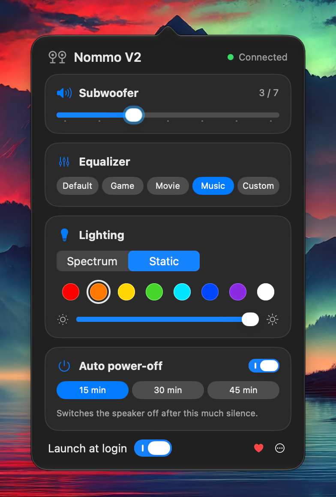

# Nommo Control

[](https://github.com/feroxes/razer-nommo-v2-macos/actions/workflows/ci.yml)
[](https://github.com/feroxes/razer-nommo-v2-macos/releases/latest)
[](LICENSE)


[](https://donatello.to/feroxes)

An unofficial macOS menu-bar app for the **Razer Nommo V2** speakers. It sets the subwoofer level, the equalizer and the lighting, which Razer Synapse can't do for this speaker on a Mac.

<p align="center">
  
</p>

## Features

- **Subwoofer** level from 1 to 7.
- **Equalizer** presets Default, Game, Movie and Music, plus a 10-band **Custom** curve (31 Hz to 16 kHz, levels from −12 to +12 per band) that the app remembers.
- **Lighting**: Spectrum (the speaker's built-in color cycle) or Static, with eight color swatches and a brightness slider.
- **Restores your lighting** whenever the speaker powers on. The speaker itself always starts in Spectrum.
- Reads the subwoofer, the equalizer and auto power-off from the speaker when it connects and each time you open the panel, and never overwrites them on its own.
- **Auto power-off**: switch it off, or choose after how much silence the speaker turns itself off: 15, 30 or 45 minutes. The speaker keeps this setting.
- Reconnects automatically. When the speaker switches itself off and comes back, the app picks it up again.
- **Updates** from inside the app: **Check for Updates…** in the ⋯ menu, with an optional daily check in the background. A dot on the menu-bar icon and a **Version X is available** row in the panel show that an update is waiting; nothing installs until you click **Install Update**. The panel's **Update…** button opens that window.
- An **About** window with the version, the source code and the license, from the ⋯ menu.
- A **Donate** item in the ⋯ menu and a red heart button in the panel, both opening the donation page.
- **Launch at login** and no Dock icon. While the speaker is off, the app stays idle until it reappears.
- A Liquid Glass panel on macOS 26 and later, and the standard popover on earlier versions.
- A `nommo` [command-line tool](#command-line-tool) for Terminal and scripts.

## Requirements

- macOS 14 Sonoma or later, on Apple Silicon or Intel (universal binary).
- A Razer Nommo V2 connected to the Mac over **USB**. Bluetooth isn't supported.
- Nommo V2 Pro and Nommo V2 X aren't supported yet. They have different USB product IDs, and Nommo Control only recognizes the Nommo V2 (`0x055C`).

## Install

1. Download `NommoControl-<version>.zip` from the [latest release](https://github.com/feroxes/razer-nommo-v2-macos/releases/latest) and unzip it. Safari may unzip it for you, in which case **Nommo Control.app** is already in Downloads.
2. Move **Nommo Control.app** to your **Applications** folder before you open it. If you open the app straight from Downloads, macOS runs it from a temporary location (App Translocation) and **Launch at login** won't work.
3. Open the app. macOS blocks the first launch because the app is not notarized by Apple. Close the warning, but don't move the app to the Trash.
4. Open **System Settings → Privacy & Security**, scroll down to **Security**, click **Open Anyway** next to the message about Nommo Control, and confirm. On macOS 14 you can instead Control-click the app in Finder and choose **Open**.

Instead of steps 3 and 4, you can remove the quarantine flag in Terminal:

```sh
xattr -dr com.apple.quarantine "/Applications/Nommo Control.app"
```

A speaker icon appears in the menu bar; click it to open the panel. To start the app with your Mac, turn on **Launch at login** in the panel. If macOS asks you to approve the login item, the app opens the Login Items settings for you.

Each release also contains `SHA256SUMS.txt`. To check a download, run this in the folder that holds the files:

```sh
shasum -a 256 -c --ignore-missing SHA256SUMS.txt
```

**Update:** the app updates itself. Choose **Check for Updates…** in the ⋯ menu at the bottom of the panel and click **Install Update** when an update is offered. On its second launch the app asks whether to check automatically; with **Check Automatically** on, it checks once a day and installs only when you click **Install Update**. You can change the choice in the ⋯ menu at any time. Your settings are kept. Version 1.0.0 has no updater, so if you have it, update once by hand: click **Quit** in the panel, replace it in Applications with the new version and allow it to open again as above.

**Uninstall:** turn off Launch at login, choose **Quit Nommo Control** in the ⋯ menu and delete the app. To also remove its settings, run `defaults delete io.github.feroxes.NommoControl`.

## Command-line tool

`nommo` controls the speaker from Terminal. Download `nommo-<version>.zip` from the same [release](https://github.com/feroxes/razer-nommo-v2-macos/releases/latest), unzip it and put the binary on your `PATH`:

```sh
unzip nommo-<version>.zip
sudo mkdir -p /usr/local/bin
sudo mv nommo /usr/local/bin/
```

If macOS refuses to run it because it can't verify the developer, clear the quarantine flag with `sudo xattr -d com.apple.quarantine /usr/local/bin/nommo`.

```text
usage: nommo <command>
  status
  sub <1-7>
  eq <default|game|movie|music>
  light spectrum | static <hex>
  brightness <0-100>
  power [on|off|15|30|45]
  watch
  -h, --help
  --version
```

| Command | What it does |
| --- | --- |
| `status` | Prints the subwoofer level, the equalizer (`default`, `game`, `movie`, `music`, `custom` or `built-in`), the brightness and auto power-off. |
| `sub <1-7>` | Sets the subwoofer level. |
| `eq <preset>` | Applies an equalizer preset. |
| `light spectrum` | Switches the lighting to the built-in color cycle. |
| `light static <hex>` | Sets one color, for example `ff7a00`. A leading `#` is optional; quote it in the shell. |
| `brightness <0-100>` | Sets the lighting brightness in percent. |
| `power` | Prints auto power-off: `off` or the delay, for example `15 min`. |
| `power on` / `power off` | Turns auto power-off on or off. With it off, the speaker never switches itself off. |
| `power <15\|30\|45>` | Turns auto power-off on with this delay in minutes. The speaker accepts no other delays. |
| `watch` | Prints `connected: …` and `disconnected` as the speaker comes and goes, until you press Ctrl-C. |

```console
$ nommo status
subwoofer 2, equalizer music, brightness 100%, auto power-off 15 min
$ nommo sub 4
subwoofer 4
$ nommo eq game
equalizer game
$ nommo light static ff7a00
lighting applied
$ nommo power 30
auto power-off 30 min
```

After changing the subwoofer, the equalizer, the brightness or auto power-off, `nommo` reads the value back from the speaker and prints only that value as the speaker reports it. The speaker has no command to read the lighting, so `light` only confirms that the command was sent. If no speaker appears within 3 seconds, it prints `Speaker not found`; errors go to stderr with exit status 1.

The CLI doesn't change the app's saved settings, so the app applies its own lighting choice again the next time the speaker powers on. The panel reads the speaker again each time you open it, so changes made with `nommo` show up there.

## Troubleshooting

- **The panel says "Speaker is off", or `nommo` prints `Speaker not found`.** The speaker is switched off or isn't connected over USB. Switch it on and connect the USB cable; the app picks it up as soon as it appears.
- **Launch at login doesn't work, or stopped working after an update.** Make sure the app is in your Applications folder (see step 2 of [Install](#install)). The app registers Launch at login again after an update. If macOS asks you to approve the login item, or it is still off, turn **Launch at login** off and on again in the panel. Releases are signed ad hoc, so each version has a different code signature, and macOS may not match the login item to the updated app.

## Build from source

You need Xcode 26 or later, or Command Line Tools with Swift 6.2 or later.

```sh
git clone https://github.com/feroxes/razer-nommo-v2-macos.git
cd razer-nommo-v2-macos
swift build
swift test
scripts/build-app.sh
```

`scripts/build-app.sh` builds universal (arm64 and x86_64) release binaries, signs them ad hoc and creates:

- `build/Nommo Control.app` and `build/NommoControl-<version>.zip`
- `build/nommo` and `build/nommo-<version>.zip`

The version comes from `git describe --tags`, or from the `NOMMO_VERSION` environment variable when it is set; the script writes it into the app's `Info.plist` (as both `CFBundleShortVersionString` and `CFBundleVersion`) and embeds it in the `nommo` binary. It also embeds Sparkle in the app and checks the result with `scripts/check-app.sh`. The script prints the paths of both zips.

To try the CLI without packaging it, run `swift run nommo status`. See [CONTRIBUTING.md](CONTRIBUTING.md) for a test quirk with Command Line Tools.

## How it works

The app talks to the speaker through USB HID feature reports using IOKit. It needs no driver, no kernel extension and no special permissions, and it never touches the audio stream. Only the commands that were confirmed on a Nommo V2 are used. Every change to the subwoofer, the equalizer, the brightness and auto power-off is read back from the speaker; the lighting can't be read back, because the speaker has no command for it.

- [docs/PROTOCOL.md](docs/PROTOCOL.md) describes the report format and the commands.
- [docs/ARCHITECTURE.md](docs/ARCHITECTURE.md) explains how the code is organized.

### Privacy

Nommo Control contacts GitHub only to read the update feed (`appcast.xml`) and to download an update. It does this once a day if you allowed automatic checks, and when you choose **Check for Updates…**. Sparkle's system profile is off, and the app collects no data. The app keeps its settings on your Mac. The red heart button and the **Donate** menu item only open the donation page in your browser. The `nommo` command-line tool makes no network connections.

### Not supported

Bluetooth, THX Spatial Audio (it is audio processing on a Windows PC, not a speaker setting), audio-reactive or other animated lighting effects, and firmware updates.

## Support the project

[](https://donatello.to/feroxes)

Nommo Control is free and open source. If it's useful to you, you can support its development with a donation on [Donatello](https://donatello.to/feroxes). Donations are voluntary and unconditional, with no rewards attached. The red heart button in the footer of the app's panel and **Donate** in its ⋯ menu open the same page.

## Acknowledgements

In-app updates use [Sparkle](https://sparkle-project.org), which is released under the MIT license.

## Contributing

Bug reports and pull requests are welcome. When you report a bug, please include your macOS version and speaker model. See [CONTRIBUTING.md](CONTRIBUTING.md) for how to build, test and match the code style, and [CHANGELOG.md](CHANGELOG.md) for what changed between releases. Please report security problems privately, as described in [SECURITY.md](SECURITY.md).

## Disclaimer

Unofficial community project. Not affiliated with, authorized, sponsored or endorsed by Razer Inc. RAZER, NOMMO, SYNAPSE and THX are trademarks or registered trademarks of Razer Inc. and/or its affiliated companies, used only to identify the compatible device and related products.

Nommo Control sends undocumented USB commands to the speaker. They were worked out by observing the device, not from official documentation. Use the app and the CLI at your own risk: the software is provided as is, without warranty of any kind.

## License

[MIT](LICENSE) © 2026 feroxes
