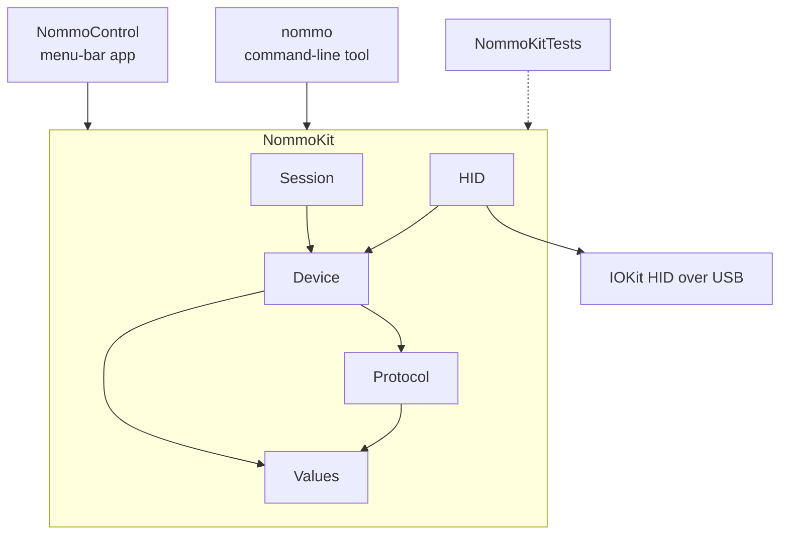
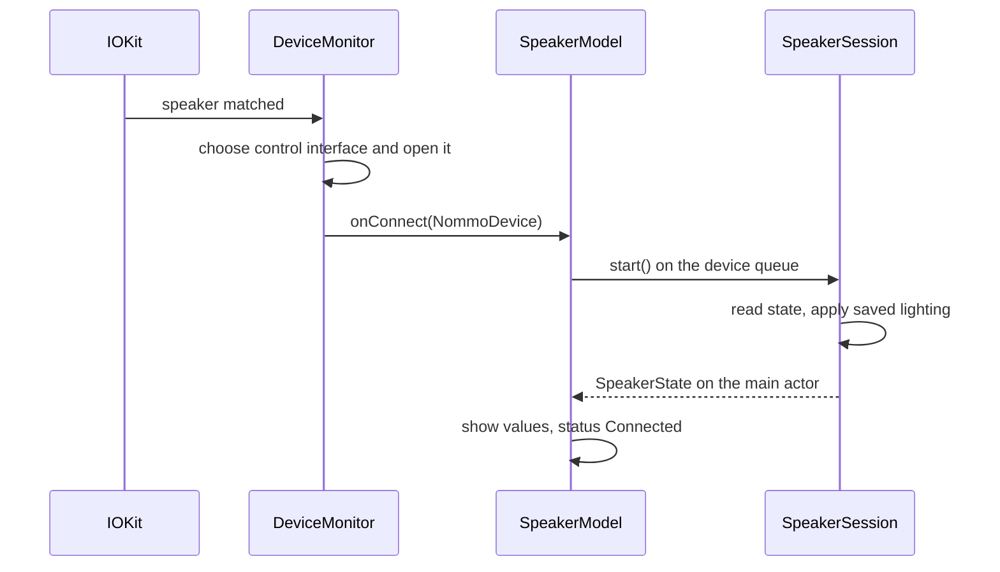

# Architecture

Nommo Control is a Swift package with one library and two executables. It needs Swift 6.2 or later (`swift-tools-version` 6.2, because `DeviceMonitor` uses `isolated deinit`), uses Swift 6 language mode and targets macOS 14.

| Target | Folder | Role |
| --- | --- | --- |
| `NommoKit` | [`Sources/NommoKit`](../Sources/NommoKit) | Everything that knows about the speaker: values, the wire protocol, device access and the connect logic. |
| `NommoControl` | [`Sources/NommoControl`](../Sources/NommoControl) | The menu-bar app, built with AppKit and SwiftUI. |
| `NommoCLI` (product `nommo`) | [`Sources/NommoCLI`](../Sources/NommoCLI) | The command-line tool. |
| `NommoKitTests` | [`Tests/NommoKitTests`](../Tests/NommoKitTests) | swift-testing suites for `NommoKit`. |

## NommoKit

| Folder | Responsibility | Main types |
| --- | --- | --- |
| `Values` | Speaker values that are valid by construction. They clamp or reject out-of-range input. | `SubwooferLevel`, `EqualizerCurve`, `EqualizerPreset`, `EqualizerSelection`, `Brightness`, `LightColor`, `LightingMode` |
| `Protocol` | Builds and parses the 91-byte reports described in [PROTOCOL.md](PROTOCOL.md). Pure functions, no I/O. | `PacketLayout`, `CommandCode`, `CommandFrame`, `SpeakerCommand`, `Packet`, `Reply` |
| `Device` | Reads and writes settings over an abstract transport. Every subwoofer, equalizer and brightness write is followed by a read, and the method returns what the speaker reports. Lighting writes aren't, because the speaker has no command to read the lighting. | `NommoDevice`, `ReportTransport`, `SpeakerState`, `SpeakerError` |
| `HID` | Finds the speaker and exchanges reports through IOKit. | `DeviceMonitor`, `IOHIDTransport`, `HIDConstants` |
| `Session` | What happens when the speaker connects, and the saved settings. | `SpeakerSession`, `SettingsStore` |

The public API is limited to what the app and the CLI use. Wire-level types (`Packet`, `Reply`, `CommandFrame`, `SpeakerCommand`, `ReportTransport`, …) are internal, and the tests reach them with `@testable import`.

- **`DeviceMonitor`** matches vendor `0x1532` and product `0x055C` with an `IOHIDManager` on the main run loop. It picks the interface whose maximum feature report size is at least 90 bytes, opens it without exclusive access and hands a `NommoDevice` to `onConnect`. It calls `onDisconnect` when that device disappears. While no speaker is attached it does nothing; IOKit calls it when one appears.
- **`IOHIDTransport`** sends a feature report and then polls for the reply every 3 ms, up to 20 times, while the reply is still pending.
- **`SpeakerSession.start()`** runs once per connection. It reads the speaker's state (up to three attempts, 0.5 s apart), remembers the speaker's curve when it is a custom one rather than a preset, and applies the saved lighting. It never writes the subwoofer or the equalizer: for those, the speaker is the source of truth.
- **`SettingsStore`** keeps two values in `UserDefaults` as JSON: `lighting` (for example `{"kind":"spectrum"}` or `{"kind":"staticColor","color":{"red":0,"green":229,"blue":255}}`) and `customCurve` (`{"gains":[…]}`). Unreadable values fall back to Spectrum and a flat curve.

## App

- **`main.swift`** starts `NSApplication` with the accessory activation policy, so the app has no Dock icon. `Resources/Info.plist` also sets `LSUIElement`.
- **`AppDelegate`** creates the `SpeakerModel` and the `StatusItemController`.
- **`SpeakerModel`** is the `@MainActor @Observable` state behind the panel. It owns the `DeviceMonitor` and runs all device I/O on one serial background queue, then applies the results on the main actor. Results from a device that has since gone away are ignored.
  - A failed exchange marks the speaker as off and asks the monitor to reconnect every 2 seconds until the speaker answers or is unplugged.
  - Sliders write only when released.
  - Lighting writes are coalesced: while one is in flight, only the most recent request is kept.
- **`StatusItemController`** puts an `NSStatusItem` in the menu bar and shows a transient `NSPopover` that hosts the SwiftUI `PanelView`. On macOS 26 and later the system draws that popover with Liquid Glass.
- **`Views/`** contains the panel pieces: header, subwoofer, equalizer (with the custom curve editor), lighting (with the color swatches), the "speaker is off" tile and the footer with Launch at login, the donate button and Quit.
- **`LaunchAtLogin`** wraps `SMAppService.mainApp`.
- **`Strings.swift`** holds all UI text. `LightingPalette`, `EqualizerBands`, `AppIdentifier` and `ProjectLinks` hold the remaining named values. `SpeakerGlyph` draws the menu bar icon (two round speakers on stands) as a template image; `scripts/make-icon.swift` draws the app icon, and `scripts/make-icon.sh` turns it into `Resources/AppIcon.icns`.

The entry point is AppKit rather than a SwiftUI `App`, and views get their state from the model or from bindings instead of `@State`. This keeps the app buildable with Command Line Tools, which don't include the SwiftUI macro plugins.

## CLI

- **`main.swift`** turns the arguments into a `CLIRequest`: help, version, watch, or a device command (`CLICommand`). Anything else prints usage to stderr and exits with status 1.
- **`SpeakerRunner`** starts a `DeviceMonitor` and runs the main run loop for up to 3 seconds until the speaker connects. It then runs the command, prints the result and exits. `watch` keeps the run loop going and prints every connect and disconnect.
- **`CLIKeyword`** holds the argument words, **`CLIOutput`** all printed text, **`CLIProcess`** the exit codes and stderr output. **`CLIVersion`** reads the version from the `Info.plist` that `scripts/build-app.sh` embeds in the binary; a plain `swift build` has none and reports `dev`.

## Concurrency

- The whole package builds in Swift 6 language mode.
- `DeviceMonitor` is `@MainActor`. Its IOKit callbacks arrive on the main run loop and enter the main actor with `MainActor.assumeIsolated`.
- `NommoDevice` is `@unchecked Sendable` because access to it is serialized: on the model's serial queue in the app, and on the main thread in the CLI.
- `SettingsStore` is `@unchecked Sendable` and relies on `UserDefaults` being thread-safe.

## Tests

`Tests/NommoKitTests` has one suite per area: Packet, Values, Commands, Device, Monitor and Session. `FakeTransport` emulates the speaker's registers in memory: a write stores its arguments, and the matching read returns them. `InMemoryDefaults` stands in for `UserDefaults`. No test touches real hardware.

## Build and release

- [`scripts/build-app.sh`](../scripts/build-app.sh) builds both executables for arm64 and x86_64, joins them with `lipo`, writes the version from `git describe --tags` into the app's `Info.plist` and into a small `Info.plist` that it links into the `nommo` binary (section `__TEXT,__info_plist`, which `Bundle.main` reads), signs both ad hoc and zips them.
- SwiftPM records the deployment target (macOS 14) as the SDK version in each binary, and macOS then runs the app in compatibility mode without Liquid Glass. The script therefore rewrites that field with `vtool` to the SDK it actually built with, taking the deployment target from `LSMinimumSystemVersion` in `Resources/Info.plist`.
- [`.github/workflows/ci.yml`](../.github/workflows/ci.yml) builds, tests and packages every push and pull request to `main`.
- [`.github/workflows/release.yml`](../.github/workflows/release.yml) runs on a `v*` tag, checks that both binaries contain arm64 and x86_64 and record SDK 26 or later, and publishes both zips and their SHA-256 checksums to a GitHub Release. Tags with a hyphen, such as `v1.1.0-beta`, become pre-releases.
